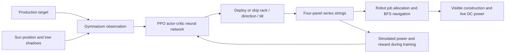

# Solar Grove · Reinforcement Learning for Solar-Array Design

**Give a production target. A trained PPO policy designs the array. Two robots build it.**


Solar Grove is a playable machine-learning project combining **deep reinforcement learning, simulated solar physics, and robot task execution**. A neural policy observes sunlight, tree shadows and a requested power target, then chooses rack deployment, panel direction and tilt. A retro pixel-art meadow makes its decisions visible as robots construct the farm.


**200,704 training steps · 2,048 training scenarios · 200 held-out evaluation scenarios · bundled trained checkpoint**

[Play](#production-challenge) · [ML architecture](#how-the-ml-works) · [Results](#held-out-results) · [Train and evaluate](#train-and-evaluate) · [Detailed experiment report](docs/ML_RESULTS.md)

## What this project demonstrates

- **Custom RL environment:** a Gymnasium environment with explicit observations, actions, rewards, episode boundaries and seeded scenarios.
- **Deep reinforcement learning:** an actual PyTorch actor-critic policy trained with Stable-Baselines3 PPO, directly controlling array-design decisions in the game.
- **Reproducible evaluation:** paired scenarios shared by learned, random, fixed-orientation and deterministic-planner controllers; raw CSV/JSON results are included.
- **ML-to-simulation integration:** checkpoint loading, deterministic inference, construction job assignment and collision-aware BFS navigation.
- **Engineering verification:** environment-contract checks, physics consistency, model serialization, robot execution and offscreen UI tests.

**Scope of learning:** PPO learns the array design. Robot navigation and construction scheduling use deterministic algorithms. This is a centralized design policy executed by two simulated robots, rather than decentralized multi-agent RL or learned robot locomotion.

## Production challenge

The only game mode in this repository: command a power target and let the trained PPO policy design the array while robots build it.

### Quick start

Python **3.10+** recommended. The game includes a lightweight pretrained array policy; no training or API keys are needed to try it.

```bash
git clone https://github.com/divyeshparekh9496/Multi-Robot-Solar-Farm-Simulation.git
cd Multi-Robot-Solar-Farm-Simulation
python -m venv .venv
source .venv/bin/activate
# Windows: .venv\Scripts\activate
pip install -r requirements.txt
python game.py --designer ppo
```

Press **Enter**, type **`produce 1 kW`**, and press **Enter** again. Watch the policy select a design and the robot team build it. The journal labels the active PPO controller.

| Control | Action |
| --- | --- |
| Enter | Type and submit a production order, such as `produce 800 W` |
| L | Switch California, Kenya, Australia or Norway |
| [ / ] | Move solar time backward / forward by half an hour |
| D | Toggle a sunlight sweep; design decisions refresh every half solar hour |
| Space | Pause construction and sunlight progression |
| R | Restart the default mission |
| Esc | Cancel command entry or exit |

Commands are parsed locally using a small grammar; no language model is involved. Explicit `--designer ppo` requires the checkpoint and does not substitute a planner. `python game.py` automatically selects the bundled policy when present, otherwise displays the planner as the active controller.

## How the ML works

The learning task is **goal-conditioned, sequential array design**. At each of three rack positions, the policy chooses whether to deploy a rack and how to orient it. It learns from reward generated by the simulator, without planner demonstrations or supervised optimal-action labels.



| RL component | Implementation |
| --- | --- |
| Algorithm | Model-free **Proximal Policy Optimization (PPO)** |
| Framework | **PyTorch**, **Stable-Baselines3**, **Gymnasium** |
| Policy network | `MlpPolicy`; two hidden layers of **64 units** |
| Observation | **21 floats:** sun vector, 12 shadow indicators, target, decision stage, accumulated design power and rack count |
| Action space | `Discrete(21)`: skip, or 4 facing directions × 5 tilt angles |
| Episode | **3 decisions**, one for each available rack row |
| Reward | Increased target coverage, material cost, terminal success / shortfall feedback |
| Scenario variation | Region, solar time, production target and tree height |
| Training setup | **8 vector environments**, seed **42**, **200,704 actual steps** |
| Checkpoint | [Bundled policy](checkpoints/array_ppo.zip) and [metadata / SHA-256](checkpoints/array_ppo.json) |

For target coverage `c = min(power / target, 1)`, the per-decision reward is:

```text
2 × (new coverage − previous coverage)
− 0.04 if a rack is deployed
+ terminal feedback: +0.5 for success, otherwise −0.5 × remaining coverage gap
```

PPO optimizes a clipped policy objective alongside a value function. The actor chooses rack actions; the critic estimates expected return during training. The playable controller runs the saved policy in deterministic inference mode.

## Held-out results

The bundled checkpoint was evaluated on **200 paired scenarios**, seeds **20000–20199**, excluded from the training pool of seeds **0–2047**. Every controller receives the same sunlight, shadow conditions and target. Metrics measure completed design output before robot animation.

| Controller | Overall target success | Success on 114 planner-feasible targets | Mean panels |
| --- | ---: | ---: | ---: |
| **PPO learned policy** | **53.5%** | **93.9% — 107 / 114** | 12.00 |
| Random actions | 23.5% | 41.2% | 11.52 |
| Fixed south-facing / 30° tilt | 27.5% | 48.2% | 12.00 |
| Deterministic planner | 57.0% | 100.0% | 7.92 |

**PPO improves overall success by 30 percentage points over random actions in this run.** It approaches the planner's feasible-target success rate, but does not exceed it or match its material efficiency.

The 93.9% figure applies to the **114 targets the planner can meet**, not all 200 scenarios. PPO's overall success is 53.5%. It deploys all 12 panels in the recorded benchmark, so economical target-conditioned deployment remains an open problem. Results are from **one training seed**; the learning curve shows training return, not independent validation performance.

Evidence: [experiment report](docs/ML_RESULTS.md) · [per-scenario CSV](docs/array-ppo-evaluation.csv) · [evaluation JSON](docs/array-ppo-evaluation.json) · [learning trace](docs/array-ppo-learning.csv).

## Train and evaluate

Train a fresh array policy without overwriting the bundled checkpoint:

```bash
python train_array.py --steps 200000 --seed 42 --output models/array_ppo
python evaluate_array.py --model models/array_ppo.zip --episodes 200 --output runs/array-comparison
python game.py --designer ppo --array-model models/array_ppo.zip
```

Evaluate the included checkpoint or run the planner comparison:

```bash
python evaluate_array.py --model checkpoints/array_ppo.zip --episodes 200 --output runs/bundled-evaluation
python game.py --designer planner
```

Requested training steps round up to full rollouts. Training writes a model, metadata and monitor logs; evaluation exports CSV and JSON. The bundled checkpoint has its own recorded hash and package versions. `requirements-lock.txt` records the repository's validation dependency set; exact retraining results can vary across versions and platforms.

## Solar-array model and game world

The farm sits in a Yosemite-inspired meadow with granite peaks, a creek, pines and decorative roaming wildlife. Original procedural pixel art requires no sprite downloads.

- **Sunlight:** equinox sun direction and height vary with latitude and local solar time; cosine incidence and approximate clear-sky attenuation determine exposure.
- **Shadows:** ray tests account for tree obstructions.
- **Arrays:** up to three rows of four 100 W modules. Each row is a series string; completed equal-length strings connect in parallel at an ideal **80 V DC**.
- **Construction:** robots follow job orders, assemble racks and return to parking. Cable runs follow rows and route to a combiner cabinet. Empty tiles between rows provide service aisles.

Targets refer to **instantaneous simulated DC power**, not energy stored or guaranteed all-day output. The model omits seasons, measured irradiance, weather, panel-to-panel shading, bypass diodes, IV curves, electrical protection and real robot dynamics. Reconfiguration reuses an abstract 12-panel budget. Row spacing is a game rule, not a site-specific engineering calculation; **IEC / NEC compliance is not claimed**.

## Verify

```bash
python -m unittest discover -s tests -v
python game.py --designer ppo --screenshot docs/solar-target.png --frames 120
```

The current suite contains **15 tests**, including Gymnasium contracts, seeded resets, RL/game physics agreement, saved-policy loading, robot execution, series-string completion, production commands and UI rendering. The screenshot command runs offscreen and exits automatically.

## Repository map

| File / directory | Purpose |
| --- | --- |
| [array_rl.py](array_rl.py) | Gymnasium design environment and learned-policy adapter |
| [train_array.py](train_array.py) | PPO training and checkpoint metadata |
| [evaluate_array.py](evaluate_array.py) | Paired held-out benchmark against three baselines |
| [solar_target.py](solar_target.py) | Sun / shadow physics, arrays, missions and robot execution |
| [meadow_ui.py](meadow_ui.py) | Retro game rendering, wildlife and command controls |
| [checkpoints/](checkpoints/) | Bundled trained policy and provenance |
| [docs/ML_RESULTS.md](docs/ML_RESULTS.md) | Experiment methodology, limitations and résumé wording |
| [tests/](tests/) | Environment, inference, physics and UI checks |

## References

- [Proximal Policy Optimization paper](https://arxiv.org/abs/1707.06347)
- [Stable-Baselines3 PPO](https://stable-baselines3.readthedocs.io/en/master/modules/ppo.html)
- [Gymnasium environment creation](https://gymnasium.farama.org/introduction/create_custom_env/)
- [NOAA solar geometry](https://gml.noaa.gov/grad/solcalc/solareqns.PDF)
- [Sandia photovoltaic array principles](https://pvpmc.sandia.gov/modeling-guide/3-dc-array-iv/)
