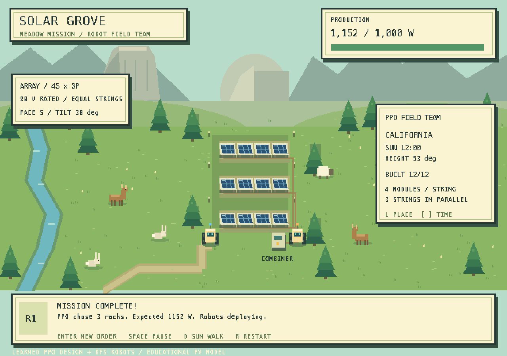

# Solar Grove · Multi-Robot Solar Farm

A retro meadow game powered by a trained **Proximal Policy Optimization (PPO)** array-design policy. Give a production target; the neural policy selects rack deployment, directions and tilts, and two robots build the farm. A separate classic salvage environment provides the original centralized robot PPO experiment.


The screenshot shows the **greedy baseline**, not PPO performance. The game works immediately with that baseline; PPO requires training a checkpoint first. Energy is an abstract game unit, not a physical solar-yield estimate.

## New default: production challenge

Run `python game.py` to command an autonomous robot team. The default mission is **produce 1,000 watts**. Press **Enter**, type `produce 800 W` or `produce 1 kW`, then press **Enter** to dispatch a new mission. The bundled PPO neural policy chooses rack deployment, directions and tilts. Two robots execute that learned design using BFS navigation. You do not need to place or wire panels.



- **Enter:** type and submit a production command. **Escape** cancels entry.
- **L:** cycle California, Kenya, Australia and Norway; the team replans.
- **[ / ]:** change local solar time by half an hour; the team replans.
- **D:** toggle a sunlight sweep, ending at 18:00. Replanning happens every half solar hour.
- **Space:** pause construction and the sunlight sweep. **R:** reset the default mission. **Esc:** exit.

### Machine learning in the meadow game

The game loads `checkpoints/array_ppo.zip` by default. The journal and footer explicitly show **PPO** when this checkpoint drives decisions. `python game.py --designer planner` selects the deterministic comparison controller; `--designer ppo` requires a valid checkpoint and never silently substitutes the planner. If the default checkpoint is absent, automatic mode labels the planner fallback honestly.

- **Technique:** model-free PPO reinforcement learning with a PyTorch actor-critic MLP, trained using Stable-Baselines3. No planner demonstrations or supervised target labels are used.
- **Observations:** 21 floats encoding the sun vector, 12 tree-shadow indicators, requested power, current decision stage, accumulated design power and rack count.
- **Actions:** three sequential rack decisions. Each chooses skip or one of 20 facing/tilt combinations. Each built rack has four modules in series; complete strings connect in parallel at an ideal 80 V.
- **Reward:** increased target coverage, a per-rack material cost, and terminal success/shortfall feedback. Training evaluates completed array output; construction navigation is not learned.
- **Training:** 200,704 environment steps, seed 42, eight vector environments, 2,048 seeded training scenarios with varied region, solar time, target and tree height. Two hidden layers of 64 units.
- **Held-out evaluation:** 200 paired scenarios, seeds 20000–20199, excluded from the training pool. PPO achieves **53.5% overall target success**, compared with **23.5% random**, **27.5% fixed south-facing**, and **57.0% planner**. Among the 114 targets the planner can meet, PPO meets **93.9%**.

PPO beats these simple baselines on this run, but does not beat the planner's success rate or material efficiency: it deploys all 12 panels on these evaluation cases, while the planner averages 7.92. This is one training seed and simulated ideal DC power, not a field-validated solar or autonomous-hardware result. The classic policy below is a different model and has different results.

```bash
# Play the bundled learned policy
python game.py --designer ppo
# Train from scratch (does not overwrite the bundled checkpoint)
python train_array.py --steps 200000 --seed 42 --output models/array_ppo
# Evaluate the newly trained checkpoint
python evaluate_array.py --model models/array_ppo.zip --episodes 200 --output runs/array-comparison
# Play it explicitly
python game.py --designer ppo --array-model models/array_ppo.zip
```

[Detailed ML results](docs/ML_RESULTS.md), [paired evaluation CSV](docs/array-ppo-evaluation.csv), [summary](docs/array-ppo-evaluation.json), [learning trace](docs/array-ppo-learning.csv). The bundled 179 KB checkpoint and its training metadata are under `checkpoints/`. Training logs and newly generated models remain local.

The 12-panel material budget is reusable. New commands or sunlight conditions can reclaim the old design; settings that change require robot construction again. This abstraction does not model physical transport or rewiring costs. Targets are instantaneous power in watts at the current sunlight conditions, not stored energy or guaranteed all-day output. If the learned design falls below the target, the game reports that outcome without claiming the target is physically impossible. The planner comparison searches row subsets and prefers fewer racks when it can meet the target.

The original retro handheld RPG interface shows a Yosemite-inspired meadow, granite mountains, a creek, pines, roaming deer, rabbits and a sheep. Procedural sprites require no downloads. Wildlife stays outside the central construction plot and is decorative. North is up. Tree heights and distances are abstract tile units. Robots can travel under panels, build racks with spark animations, and return to their parking area. Empty rack frames show pending construction. Series wiring follows each rack; orthogonal cable runs connect to the combiner cabinet without crossing the meadow diagonally. One empty tile between rack rows provides a service aisle; it is a game spacing rule, not a calculated real-world clearance.

The educational model uses an equinox sun vector based on latitude and local solar time, fixed 100 W panels (20 V, 5 A), cosine incidence, approximate clear-sky attenuation and tree ray shadows. Within a series string, voltage adds and the lowest panel exposure limits current. There are no bypass diodes, IV curves, wire losses, panel-to-panel shading, weather, seasons or geographic irradiance data. This is a game, not an installation design tool. Autonomous arrays use zero to three complete four-module strings. Each rack has internally consistent orientation and tilt; the policy can choose different settings per rack. A string stays disconnected until all four modules are built. The model sums completed string currents at a common ideal 80 V bus. Real string voltage limits, cold-weather open-circuit voltage, protective devices, earthing, conductor sizing and equipment ratings are not modeled. No IEC or NEC compliance is claimed.

Background: [NOAA solar geometry](https://gml.noaa.gov/grad/solcalc/solareqns.PDF), [UCF shading experiment](https://energyresearch.ucf.edu/resources/use/USE-27-EffectOfShading.pdf), [Sandia series/parallel array principles](https://pvpmc.sandia.gov/modeling-guide/3-dc-array-iv/), [Australian government row-spacing guidance](https://www.energy.gov.au/solar/solar-system-design/design-considerations), [IEC 62548-1 scope](https://webstore.iec.ch/en/publication/110893). These references inform the simplifications; the game is not a compliance checker.

Use `python game.py --classic` for the original salvage expedition described below. Its training environment, checkpoints and evaluation rules are unchanged; `--agent`, `--model` or `--seed` also select the classic viewer.

## Classic expedition

Python **3.10+** recommended (validated with Python 3.12).

```bash
git clone https://github.com/divyeshparekh9496/Multi-Robot-Solar-Farm-Simulation.git
cd Multi-Robot-Solar-Farm-Simulation
python -m venv .venv
source .venv/bin/activate  # Windows: .venv\Scripts\activate
pip install -r requirements.txt
python game.py
```

`requirements-lock.txt` records the versions used for validation; use `pip install -r requirements-lock.txt` to reproduce that dependency set on a supported platform.

The interface uses procedurally drawn pixel terrain, animated robots, salvage crates, solar arrays, and a live expedition HUD. No external sprites or API keys are required.

| Control | Action |
| --- | --- |
| Space | Pause / resume |
| R | Restart the same seeded map |
| N | Start the next map |
| Tab | Cycle available controllers (PPO appears when launched with a checkpoint) |
| + / - | Change simulation speed |
| E | Enter a fresh-map editor / resume the edited map |
| 1 / 2 / 3, then left-click | Paint rock / salvage / erase in the editor |
| Esc | Exit |

Editing starts a new episode and keeps the robot count fixed. Robot tiles cannot be painted. Custom editor maps may be disconnected and are for experimentation; benchmark maps are generated with connected terrain. Episodes stop at their time limit so their results remain visible.

## Machine learning: centralized PPO

One neural policy observes the full map and selects **one action for each robot**. Stable-Baselines3 supplies the actual PPO implementation, backed by PyTorch; this is not a random agent labeled as reinforcement learning.

PPO collects trajectories, estimates advantages, and optimizes a clipped policy objective alongside a value function. It suits this sequential task because building a panel earlier can pay off for many later ticks. It supports the joint `MultiDiscrete` action space without enumerating a separate action for every possible joint combination.

This is **centralized control with a shared reward**, not decentralized multi-agent PPO (MAPPO). Both robots' actions are produced from the same global state.

| RL component | Implementation |
| --- | --- |
| Environment | Headless `gymnasium.Env` in `solar_env.py` |
| Observation | Obstacle, salvage and panel maps; one occupancy map per robot; normalized inventories; remaining time |
| Shape | 323 float32 values in `[0, 1]` for the default 8×8 map and two robots |
| Actions | `MultiDiscrete([6, 6])`: north, east, south, west, build, wait for each robot |
| Policy | PPO `MlpPolicy`, two hidden layers of 128 units |
| Reward | `0.1 × production − 0.02 × successful moves − 0.05 × invalid actions` per tick |
| Episode | 300 ticks; time-limit truncation, no early terminal state |
| Training | Four vectorized environments; seeded training; separate evaluation stream and best-checkpoint callback |

Collection is automatic when a robot has capacity. Each robot holds at most two materials; each panel consumes one. A panel yields one energy unit per tick, or two if it has at least one orthogonal panel neighbor. Building is not allowed on existing panels. Total return in the HUD is exactly the sum of learning rewards; raw cumulative energy is reported separately.

Movement into a robot's starting cell is blocked for that tick, including swaps and following into a vacated cell. If both robots choose the same empty destination, the lower robot index wins. These deliberately conservative rules prevent overlapping robots. Reset places distinct robots, salvage and obstacles on connected terrain using the environment's seeded RNG.

### Train and load PPO

```bash
python train.py --steps 500000 --seed 42 --output models/solar_ppo
python game.py --agent ppo --model models/solar_ppo.zip
```

Training writes the final model, configuration metadata, episode-monitor CSVs and periodic evaluation records. The best evaluation checkpoint is saved under `models/solar_ppo_logs/best/best_model.zip`; you can load or evaluate it independently. Evaluation runs during training use a separate random stream starting at seed 10000. Final benchmark episodes explicitly reset to paired seeds starting at 20000.

Key settings: learning rate `3e-4`, rollout length `512` per environment, batch size `128`, discount `0.99`, GAE lambda `0.95`, clip range `0.2`, entropy coefficient `0.01`. Requested training steps round up to complete rollouts; metadata records the actual count. Checkpoints and training logs are local generated artifacts, excluded from Git.

For a quick integration check rather than a performance experiment:

```bash
python train.py --steps 2048 --output models/smoke
python game.py --agent ppo --model models/smoke.zip
```

**A working training loop does not imply a strong learned policy.** The flattened-map policy and delayed construction rewards can make generalization difficult. Measure held-out performance before claiming that PPO improves coordination or beats a planner. No pretrained model is bundled for this **classic salvage** environment; the bundled meadow array checkpoint is a different policy.

## Compare against baselines

```bash
# Baselines only; no checkpoint required
python evaluate.py --episodes 30

# Random, greedy, and PPO on exactly the same 30 map seeds
python evaluate.py --model models/solar_ppo.zip --episodes 30 --output runs/comparison
```

- **Random:** independently samples six actions per robot from a seeded RNG.
- **Greedy planner:** breadth-first shortest paths, resource-target assignment, reserved movement destinations, and adjacency-aware panel placement. It does not learn.
- **PPO:** deterministic inference from the supplied checkpoint, with no planner fallback.

Evaluation exports per-episode CSV data and JSON summaries with population mean and standard deviation for energy, production, panels, return and invalid actions. All controllers share the same information and environment rules. Single-checkpoint results do not establish robustness across training seeds; repeat training seeds for stronger claims.

## Verify and preview

```bash
python -m unittest discover -s tests -v
python game.py --classic --screenshot docs/solar-grove.png --frames 22
```

Tests cover the Gymnasium contract, reproducible connected resets, material conservation, collision rules, inventory capacity, rewards, time limits, fixed observations, editor controls and offscreen rendering. The screenshot command uses SDL's offscreen driver and exits automatically.

## Repository layout

```text
solar_env.py              Environment, production, shared rewards and observations
agents.py                 Random and greedy planning baselines
game.py                   Indie-style Pygame viewer and scenario editor
train.py                  PPO learning, evaluation callback and checkpoint saving
evaluate.py               Paired held-out evaluations and CSV/JSON export
tests/                    Environment and interface regression tests
docs/solar-grove.png      Actual game screenshot using the greedy controller
requirements-lock.txt     Validated dependency versions
```

## Scope and next steps

This is a grid-based construction benchmark. It does not model robot dynamics, sunlight, shading, battery discharge, real watts, weather or hardware control. Adjacency bonuses are an explicit game mechanic. Useful next experiments include convolutional observation encoders, potential-based reward shaping, collision-fairness alternatives, and curriculum training. MAPPO would be a separate extension for decentralized policies.

References: [PPO paper](https://arxiv.org/abs/1707.06347), [Stable-Baselines3 PPO](https://stable-baselines3.readthedocs.io/en/master/modules/ppo.html), [Gymnasium custom environments](https://gymnasium.farama.org/introduction/create_custom_env/).

## Recorded validation run

A local run with training seed **42** completed **501,760 timesteps** (the requested 500,000 rounded to complete rollouts). Deterministic final-checkpoint inference was evaluated on **30 paired maps, seeds 20000–20029**:

| Controller | Mean cumulative energy ± std | Mean panels | Mean episode return |
| --- | ---: | ---: | ---: |
| Random | 3196.8 ± 749.7 | 10.37 | 304.28 |
| Greedy planner | 6648.4 ± 270.5 | 12.00 | 663.85 |
| PPO, final checkpoint | 842.5 ± 778.7 | 2.13 | 60.59 |

**PPO underperformed both baselines in this experiment.** This validates training, saving, loading and evaluation, but does not demonstrate a successful learned controller. Frequent invalid actions and poor transfer to new maps are unresolved limitations. The greedy controller remains the default for a useful interactive demo. The periodic best checkpoint was not evaluated in this table. Values are game units, and this is one training seed, not a statistically robust algorithm comparison.

Raw records: [episode CSV](docs/ppo-evaluation.csv), [summary JSON](docs/ppo-evaluation.json). The trained checkpoint is a local artifact at `models/solar_ppo.zip` and is not included in the repository. Re-run training with the locked dependencies to conduct your own experiment; exact numerical reproduction can vary by platform.
